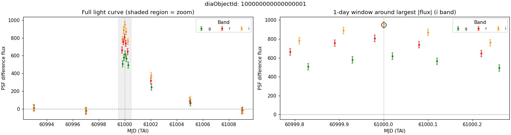

# LSST Transient Tools

**Explore a Rubin transient candidate in one notebook view.** Give the dashboard
a candidate ID from your own table and use it to ask: How did the flux change?
What’s visible at that position? Has anything nearby already been reported?

- **See the full light curve and zoom in on the strongest excursion.** Measurements
  are colored by filter and shown with error bars. The zoom uses a one-day
  window centered on the largest absolute difference flux, whether positive
  or negative, and fits the visits actually observed.
- **Compare the sky images.** Optionally display Rubin and Legacy Survey cutouts
  side by side, with the candidate position marked in each.
- **Look for possible counterparts or contaminants.** Optionally check NED,
  SIMBAD, and the Transient Name Server for nearby entries. SkyBoT checks
  whether a known Solar System object was predicted nearby at the time of
  the strongest excursion.



*Offline example using synthetic measurements. Optional archive panels are described below.*

## Install from a checkout

Requires Python 3.10 or newer. From this directory:

```sh
python -m pip install .
# Optional: enable the catalog lookup clients
python -m pip install '.[archives]'
```

The Rubin coadd panel additionally needs the Rubin Science Platform or an
equivalent LSST environment with the Butler repository and collections
accessible. LSDB is needed only if you supply an LSDB catalog.

## Quick start: plot a candidate from your own tables

Start with one table of candidate IDs and sky positions and another with one
row per photometry measurement. The call below displays the two light curves
with no archive queries.

```python
from rubin_transient_dashboard import inspect_transient

inspection = inspect_transient(
    753900763427635843,
    object_table=my_filtered_candidates,
    lightcurves=my_photometry,
)
```

Pass pandas DataFrames. Rename your columns before calling if necessary:

| Table | Required columns |
|---|---|
| Candidate table | `diaObjectId` (one row per candidate), `ra`, `dec` (ICRS degrees) |
| Long-format photometry | `diaObjectId`, `midpointMjdTai` (MJD TAI), `band` (u/g/r/i/z/y), `psfDiffFlux`, `psfDiffFluxErr_corrected` (same flux units, normally nJy) |

Read IDs from CSV with `dtype={"diaObjectId": "string"}`: floats cannot
represent Rubin IDs exactly. Convert times to MJD TAI before passing them.
Photometry is used as supplied, except that plotting omits nonfinite values,
unknown bands, and measurements with nonpositive errors.

**Already have light curves nested in your candidate table?** If each row has
a pandas light curve in `diaObjectForcedSource`, pass only `object_table`.

**Only have IDs and coordinates?** Replace `lightcurves=my_photometry` with
`catalog=dia`, where `dia` is an open LSDB catalog with the nested photometry
fields. The dashboard looks up that candidate’s light curve using its position.

## Add images and catalog lookups

Keep the same inputs and pass `panels=ALL_PANELS` for the full dashboard, or
enable just the panels you need: `rubin`, `legacy`, `ned`, `simbad`, `tns`, and
`skybot`. Here’s an example using LSDB for photometry:

```python
from rubin_transient_dashboard import ALL_PANELS, inspect_transient

inspection = inspect_transient(
    753900763427635843,
    object_table=my_filtered_candidates,
    catalog=dia,
    panels=ALL_PANELS,  # or e.g. ("legacy", "skybot", "ned")
    neighbor_radius_arcsec=2,
    skybot_radius_arcsec=10,
)
```

- Image panels mark the candidate and retain their native orientations.
  Legacy cutouts load in the notebook browser. The Rubin panel uses the
  `repository`, `collections`, and `coadd_band` settings.
- Enabling external panels sends candidate coordinates to those services
  (and the selected observation time to SkyBoT). SkyBoT defaults to observatory
  code `X05`. Nearby matches are diagnostics for inspection.
- TNS displays a search link. To query automatically, use environment variables
  `TNS_API_KEY`, `TNS_BOT_ID`, `TNS_BOT_NAME`, or pass a dictionary with
  `api_key`, `bot_id`, and `bot_name`. Keep credentials out of shared notebooks.
- The returned dictionary contains the light-curve figure and peak, enabled
  panel results, and an `errors` dictionary for service failures.

For a figure without archive panels or notebook printing, use
`resolve_target` and `plot_inspection_light_curves(..., show=False)` separately.

## Examples, troubleshooting, and release status

Run `python examples/offline_demo.py` after installing to reproduce the figure
above without any archive access or credentials.

If a candidate is missing, check that the two tables use the same exact IDs
and that the candidate table has one row per object. If a panel fails, look in
`inspection["errors"]`: a service error is different from a successful query
with no matches. The Rubin coadd is a static image for context, not a
difference image or proof of a host association. The dashboard helps you vet
individual candidates; use your own selection pipeline to build the list.

See [Contributing](CONTRIBUTING.md) for tests and [the release checklist](docs/releasing.md)
for the proposed license and live Rubin checks. This is a release draft; no
public reuse license has been applied yet.
